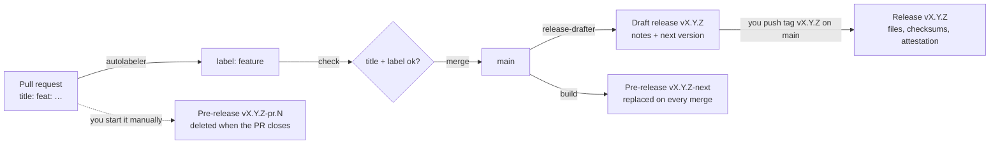

# spali/.github

Shared release configuration and reusable GitHub Actions workflows for my
repositories, independent of the programming language. A repository only
describes how to **build** its release files; everything else (release notes,
version, checks, publishing, attestation) comes from here.

- [How it works](#how-it-works)
- [Features](#features)
- [How to](#how-to): [release](#make-a-release) ·
  [exception version](#release-a-different-version) ·
  [dev build for a pull request](#give-someone-a-dev-build-of-a-pull-request) ·
  [fix the release notes](#fix-where-a-pull-request-appears-in-the-release-notes) ·
  [tag check failed](#the-tag-check-failed) · [verify a release](#verify-a-release) ·
  [emergency](#emergency-change-main-without-a-pull-request)
- [Set up a new repository](#set-up-a-new-repository)
- [Interface](#interface)
- [Maintenance](#maintenance)
- [Maintenance monitor](#maintenance-monitor)
- [Fork and mirror sync](#fork-and-mirror-sync)
- [Troubleshooting](#troubleshooting)

For AI agents: [AGENTS.md](AGENTS.md) has the same content as rules,
procedures, an error catalog and the reasons behind each design decision.

## How it works



1. Every pull request title follows [Conventional Commits](https://www.conventionalcommits.org).
   A label is derived from the title; the title and the label are checked.
2. On every merge to `main`, [release-drafter](https://github.com/release-drafter/release-drafter)
   updates a **draft release** with the notes and the next version, and a
   pre-release `vX.Y.Z-next` is built from that commit.
3. To release, push the tag of the draft on the head of `main`. The release is
   built, attested and the draft is published with its notes.

### Files in this repository

| File | Purpose |
|---|---|
| [`.github/release-drafter.yml`](.github/release-drafter.yml) | Labels, release note categories, version rule, notes template |
| [`.github/workflows/pr.yml`](.github/workflows/pr.yml) | Reusable: label and check pull requests, delete dev builds of closed ones |
| [`.github/workflows/image-cleanup.yml`](.github/workflows/image-cleanup.yml) | Reusable: delete the container images of closed pull requests and of superseded `-next` builds |
| [`.github/workflows/release-prepare.yml`](.github/workflows/release-prepare.yml) | Reusable: update the draft, check a pushed tag, decide kind and version |
| [`.github/workflows/release-publish.yml`](.github/workflows/release-publish.yml) | Reusable: checksums, attestation, publish |
| [`.github/workflows/monitor.yml`](.github/workflows/monitor.yml), [`monitor-config.yml`](.github/workflows/monitor-config.yml) | Reusable: the [maintenance monitor](#maintenance-monitor) and the validation of its control file, called from a private control repository |
| [`.github/workflows/sync.yml`](.github/workflows/sync.yml) | Reusable: the [fork and mirror sync](#fork-and-mirror-sync) of the own forks and the `forks:` entries, called from the private control repository |
| [`.github/workflows/profile-cards.yml`](.github/workflows/profile-cards.yml) | Reusable: the [profile cards](#profile-cards) of the profile repository, called from the private control repository |
| [`scripts/`](scripts) | The logic of the reusable workflows (Bash), tested in [`tests/`](tests) |
| [`docs/monitor-checks.md`](docs/monitor-checks.md) | What each check of the maintenance monitor means and how to fix a finding |
| [`examples/caller/`](examples/caller) | Workflows to copy into a repository |

The reusable workflows load their scripts and `release-drafter.yml` from the
same commit of this repository that the caller pinned (`job.workflow_sha`), so
a repository always runs one consistent version of everything here.

## Features

### Pull request titles and labels

The title becomes the entry in the release notes:
`<type>[(<scope>)][!]: <description>`, with the type one of `build`, `chore`,
`ci`, `docs`, `feat`, `fix`, `perf`, `refactor`, `revert`, `style`, `test`.

When a pull request is opened, reopened or its title is edited, exactly one
label is added (first match wins):

| Title | Label | Release notes section | Version |
|---|---|---|---|
| any type with `!`, e.g. `feat!:`, `fix(api)!:` | `breaking-change` | Breaking Changes | major |
| `<type>(deps):`, e.g. Renovate's `fix(deps):` | `dependencies` | Dependencies | patch |
| `feat:` / `feat(<scope>):` | `feature` | Features | minor |
| `fix:` / `fix(<scope>):` | `fix` | Fixes | patch |
| everything else | `other` | Others | patch |

**Override:** change the label by hand. Labels you set are kept (the
autolabeler only adds). If a pull request has several of these labels, the
first section in the table wins, and the version takes the highest increment.

**Check** (`pr / check`, required for merging): the title must follow the
format and the pull request must have one of the five labels. It runs on every
change of the pull request, also when you change a label.

### Version rule

The next version is the last published release plus the highest increment of
all merged pull requests since: breaking → major, feature → minor, everything
else → patch. There is no special rule for 0.x: a breaking change in 0.4.2
gives 1.0.0. Pre-releases (`-rc.1`, `-next`, `-pr.N`) are never the base.

### Draft release

release-drafter keeps one draft release per repository, named and tagged
`vX.Y.Z`, updated on every merge to `main`. Read it on the releases page to see
what the next release will contain. Edits by hand are overwritten by the next
merge, so add text (e.g. before/after tables of a breaking change) right
before you tag.

### Releases and the tag check

A pushed tag `vX.Y.Z` (or `vX.Y.Z-<suffix>`) starts the release. It only
continues if

1. a **draft** with exactly this tag exists,
2. the tag points to the **head of `main`**, and
3. the Release run for that commit on `main` finished successfully (so the
   draft was computed from it).

Before publishing, the draft and the head of `main` are checked again: a merge
during the build stops the release.

Otherwise nothing is built and the run fails with the reason. A version with a
suffix (`2.0.0-rc.1`) is published as a pre-release, otherwise as Latest.

### `-next` pre-release

After every merge to `main` a pre-release `vX.Y.Z-next` (the draft's version)
is built from that commit with the draft's notes. All older `-next`
pre-releases and their tags are deleted first, so there is always at most one.
Publishing a release deletes the `-next` pre-release too.

### Dev builds of pull requests

Started by hand on a pull request branch of this repository (not on forks):
a pre-release `vX.Y.Z-pr.N` with the files, and a comment on the pull request
with the link (updated on the next build). A new build for the same pull
request replaces the old one; closing or merging the pull request deletes it.

### Container images

Repositories that publish a container image to ghcr.io can call
[`image-cleanup.yml`](.github/workflows/image-cleanup.yml). It deletes the
image tags `X.Y.Z-pr.N` and `X.Y.Z-next` once their pre-release is gone, plus
untagged images that belong to no tagged image and orphaned attestations.
Release images (`X.Y.Z`, `X.Y`, `X`, `latest`, exception versions) are never
deleted. It is safe for multi-arch images. Repositories without an image need
no change. The cleanup is eventual: an image is deleted by the next cleanup
run (next merge, release or pull request close) once it is older than 2 hours,
and after a release the `next` tag keeps pointing at the last next image until
the next merge.

### Attestation

Every published file set gets `checksums.txt` and a build provenance
attestation over it, signed by the `release-publish.yml` workflow of this
repository. GitHub does not store attestations for private user-owned
repositories; there the step is skipped with a notice.

### Branch and tag protection

Each repository has two rulesets, without any bypass (also not for the owner):

- `main`: changes only through pull requests (no review required, merge by
  rebase or squash), required checks must pass, no force push, no deletion.
- release tags `v*` (except `v*-next`, `v*-pr.*`): cannot be moved. Deleting
  is allowed, so a tag that failed the tag check can be removed. **Never delete
  the tag of a published release.**

## How to

All commands run in the repository you release, with the [GitHub CLI](https://cli.github.com).

### Make a release

1. Wait until the Release run of the last merge to `main` is green
   (`gh run list --workflow Release --branch main --limit 1`): it updates the draft.
   Open the releases page (`gh release list`) and read the draft `vX.Y.Z`.
   Wrong section or version? See [fix the release notes](#fix-where-a-pull-request-appears-in-the-release-notes).
2. Optionally add text to the draft (e.g. migration notes for breaking changes).
3. Tag the head of `main` with exactly the draft's tag and push it:
   ```sh
   git switch main && git pull --ff-only
   git tag vX.Y.Z
   git push origin vX.Y.Z
   ```
4. Watch the run: `gh run watch`. The draft becomes the release with the files.

### Release a different version

For a version the labels would not give (a release candidate, a planned 1.0.0, …):

1. Start the release workflow on `main` with the version:
   ```sh
   gh workflow run Release --ref main -f version=2.0.0-rc.1
   ```
   The draft is now `v2.0.0-rc.1` (and the `-next` pre-release follows it).
   The version is SemVer without `v` and without build metadata (`+…`); `-next`
   at the end and `-pr.` anywhere are reserved for pre-releases. Other values
   fail before the draft changes.
2. Push exactly that tag on the head of `main` as in [make a release](#make-a-release).
   If something was merged in between, the draft is back at the computed
   version and the tag check fails: start again from step 1.

### Give someone a dev build of a pull request

1. The pull request branch must be in this repository. For a pull request from
   a fork, push its commits to a branch here and open a pull request from it.
2. Start the build on the branch:
   ```sh
   gh workflow run Release --ref <branch>
   ```
3. The pull request gets a comment with the link to `vX.Y.Z-pr.N`; pass it on.
   Run step 2 again after new commits.

### Fix where a pull request appears in the release notes

- Before merging: fix the title **and remove the old label** (labels are only
  added, never removed automatically), or just change the label. The check
  warns when a pull request has several release labels.
- After merging: change the label on the merged pull request, then update the
  draft by starting the release workflow on `main`:
  `gh workflow run Release --ref main`.

### The tag check failed

The run log names the reason:

| Message | What to do |
|---|---|
| `no draft release for vA (current draft: vB)` | Wrong tag. Delete it, push `vB`. |
| `no draft release for vA (no draft exists, …)` | Nothing merged since the last release. Delete the tag. |
| `tag vA points to X but main is at Y` | Something was merged after you tagged, or you tagged an old commit. Check the draft again, delete the tag, tag the head of `main`. |
| `the draft is not up to date for main at X` | You tagged before the Release run on `main` finished. Wait until it is green, then re-run the failed run (`gh run rerun <id>`), the tag can stay. |
| `main moved to X while building Y` | A merge happened during the build. Delete the tag, check the draft, tag the head of `main` again. |
| `release N is no longer the draft for vA` | The draft was published or changed meanwhile. Check the releases page. |
| `several draft releases for vA (ids …)` | Delete all but one of the drafts, then re-run the failed run. |

Delete a tag: `git push --delete origin vA && git tag -d vA`.

### Verify a release

```sh
gh release download vX.Y.Z --repo spali/<repo> --pattern '<file>' --pattern checksums.txt
gh attestation verify <file> --repo spali/<repo>
# stricter: the file was attested by the shared publish workflow
gh attestation verify <file> --repo spali/<repo> \
  --signer-workflow spali/.github/.github/workflows/release-publish.yml
sha256sum --check --ignore-missing checksums.txt
```

### Emergency: change `main` without a pull request

There is no bypass. Settings → Rules → Rulesets → `main` → Enforcement status
**Disabled**, make the change, then set it back to **Active**.

## Set up a new repository

Works for any language. Steps 1–4 are files, 5–9 are settings.

1. **Workflows:** copy [`examples/caller/pr.yml`](examples/caller/pr.yml) to
   `.github/workflows/pr.yml` and one of the release examples to
   `.github/workflows/release.yml`:
   - [`release-generic.yml`](examples/caller/release-generic.yml): any build,
     replace the `Build` step.
   - [`release-go.yml`](examples/caller/release-go.yml): Go with goreleaser.
   - [`release-library.yml`](examples/caller/release-library.yml): nothing to
     build (e.g. a library): no `build` job, releases without files.

   Repositories that publish a container image also add the two
   `image-cleanup` jobs from the [interface](#interface). Replace every
   `SHA # vX.Y.Z` with the commit and tag of the latest release
   of this repository:
   ```sh
   tag=$(gh release view --repo spali/.github --json tagName --jq .tagName)
   gh api repos/spali/.github/commits/$tag --jq .sha   # the SHA to pin
   ```
2. **Build job:** see [interface](#interface). It builds from
   `needs.prepare.outputs.sha` with `needs.prepare.outputs.version` and
   uploads the files as the artifact `release-assets`. No `checksums.txt`.
   For goreleaser, in `.github/goreleaser.yml`:
   ```yaml
   snapshot:
     version_template: "{{ .Env.VERSION }}"
   checksum:
     disable: true
   ```
3. **Renovate:** `.github/renovate.json` with
   `helpers:pinGitHubActionDigests` (see [this repository's](.github/renovate.json)),
   so the pinned `spali/.github` commits are updated. Automatic updates merge
   by rebase (`"automergeStrategy": "rebase"`) through GitHub auto-merge as
   soon as the required checks are green (`"platformAutomerge": true`; in a
   private repository without rulesets `false`, so Renovate waits for the
   checks itself).
4. **First release:** without any published release, release-drafter has no
   baseline and the first draft lists no pull requests. Merge the setup, then
   release that first draft (or an [exception version](#release-a-different-version)).
5. **Labels:**
   ```sh
   gh label create breaking-change --color b60205 --force --description "Breaking change, next major version"
   gh label create dependencies --color 0366d6 --force --description "Dependency update"
   gh label create feature --color a2eeef --force --description "New feature, next minor version"
   gh label create fix --color d73a4a --force --description "Bug fix"
   gh label create other --color cfd3d7 --force --description "Maintenance, docs, CI, refactoring"
   ```
6. **Repository settings:** merge with rebase or squash only (the squash
   commit takes the pull request title), delete branches after merge,
   auto-merge allowed (public repositories with Renovate; only accounts with
   write access can turn it on for a pull request),
   Dependabot alerts and private vulnerability reporting on. Actions: workflow
   permissions *Read repository contents*, GitHub Actions may not create or
   approve pull requests, fork pull request workflows need approval for all
   external contributors (a fork pull request chooses its own `runs-on`, so it
   can pick a self-hosted runner; not for private repositories).
   ```sh
   gh api -X PATCH repos/spali/<repo> -F allow_merge_commit=false \
     -F allow_squash_merge=true -F allow_rebase_merge=true -F delete_branch_on_merge=true \
     -f squash_merge_commit_title=PR_TITLE -f squash_merge_commit_message=COMMIT_MESSAGES
   # public repositories with Renovate only
   gh api -X PATCH repos/spali/<repo> -F allow_auto_merge=true
   gh api -X PUT repos/spali/<repo>/vulnerability-alerts
   gh api -X PUT repos/spali/<repo>/private-vulnerability-reporting
   gh api -X PUT repos/spali/<repo>/actions/permissions/workflow \
     -f default_workflow_permissions=read -F can_approve_pull_request_reviews=false
   # public repositories only
   gh api -X PUT repos/spali/<repo>/actions/permissions/fork-pr-contributor-approval \
     -f approval_policy=all_external_contributors
   ```
   Turn off what the repository does not use (wiki, projects, discussions).
7. **Rulesets** (after the workflows ran once, so the check names exist).
   Put the repository's own required checks next to `pr / check`:
   ```sh
   gh api -X POST repos/spali/<repo>/rulesets --input - <<'EOF'
   {"name": "main", "target": "branch", "enforcement": "active", "bypass_actors": [],
    "conditions": {"ref_name": {"include": ["~DEFAULT_BRANCH"], "exclude": []}},
    "rules": [{"type": "deletion"}, {"type": "non_fast_forward"},
      {"type": "pull_request", "parameters": {"required_approving_review_count": 0,
        "dismiss_stale_reviews_on_push": false, "require_code_owner_review": false,
        "require_last_push_approval": false, "required_review_thread_resolution": false,
        "allowed_merge_methods": ["rebase", "squash"]}},
      {"type": "required_status_checks", "parameters": {"strict_required_status_checks_policy": false,
        "required_status_checks": [{"context": "pr / check"}]}}]}
   EOF
   gh api -X POST repos/spali/<repo>/rulesets --input - <<'EOF'
   {"name": "release tags", "target": "tag", "enforcement": "active", "bypass_actors": [],
    "conditions": {"ref_name": {"include": ["refs/tags/v*"],
      "exclude": ["refs/tags/v*-next", "refs/tags/v*-pr.*"]}},
    "rules": [{"type": "update"}]}
   EOF
   ```
8. **Renovate app:** make sure the Renovate GitHub app has access to the
   repository (GitHub → Settings → Applications → Renovate → Configure).
9. **Image repositories only:** if the `image-cleanup` job cannot delete,
   note that the action needs the repository to have the Admin role under the
   package's Manage Actions access (package settings).

## Interface

`release.yml` in a repository has three jobs: `prepare` and `publish` call this
repository, `build` is the repository's own. Repositories with a container
image add a fourth job `image-cleanup` (see the image-cleanup paragraph
below).

**`release-prepare.yml`** (needs `contents: write`, `pull-requests: read`, `actions: read`)

| Input | |
|---|---|
| `version` | optional exception version, only on `main` |

| Output | Example | |
|---|---|---|
| `kind` | `release`, `next`, `pr` | what is published |
| `version` | `1.2.0`, `1.2.0-next`, `1.2.0-pr.7` | without `v`, pass to the build |
| `tag` | `v1.2.0` | |
| `sha` | commit | check out and build this commit |
| `pr` | `7` | only for `pr` |
| `draft-id` | `445321074` | only for `release` and `next` |

**`build`** (repository): `needs: prepare`, builds `sha` with `version`,
uploads all files to publish as the artifact **`release-assets`**
(`actions/upload-artifact`). It must not write `checksums.txt` or publish.

**`release-publish.yml`** (needs `contents: write`, `pull-requests: write`,
`id-token: write`, `attestations: write`, `artifact-metadata: write`): takes
all outputs of `prepare` as inputs of the same name. Optional input `assets`
(default `true`): `false` for a repository without files to release (e.g. a
library). It then has no `build` job, `publish` needs only `prepare`, and the
releases carry only the notes and the tag (no `checksums.txt`, no attestation).

**`image-cleanup.yml`** (needs `contents: read`, `packages: write`): input
`package` (default: the repository name). Call it as a job `image-cleanup`:

```yaml
# release.yml
  image-cleanup:
    needs: publish
    permissions:
      contents: read
      packages: write # delete image versions
    uses: spali/.github/.github/workflows/image-cleanup.yml@SHA # vX.Y.Z

# pr.yml
  image-cleanup:
    needs: pr
    if: github.event.action == 'closed'
    permissions:
      contents: read
      packages: write # delete image versions
    uses: spali/.github/.github/workflows/image-cleanup.yml@SHA # vX.Y.Z
```

**`pr.yml`** (needs `contents: write`, `pull-requests: write`): called from
`pull_request_target` with the types `opened, reopened, edited, synchronize,
labeled, unlabeled, closed`. It never checks out code of the pull request, so
`pull_request_target` is safe and labels pull requests from forks too.

**`monitor.yml`** (needs `contents: read`, `issues: write`): inputs
`app-client-id` (required) and `config` (default `repos.yml`), secrets
`app-key` and `account-token` (optional, enables the billing check).
**`monitor-config.yml`** (needs `contents: read`): input `config`.
See [Maintenance monitor](#maintenance-monitor).

**`sync.yml`** (needs `contents: read`): inputs `app-client-id` (required),
`config` (default `repos.yml`), `repo` and `branch` (default empty), secret
`app-key`. See [Fork and mirror sync](#fork-and-mirror-sync).

**`profile-cards.yml`** (needs `contents: read`): inputs `app-client-id` and
`cards` (required), `repository` and `branch` (default empty), secrets `token`
and `app-key`. See [Profile cards](#profile-cards).

The release workflow must keep the tag filters of the examples: `-next` and
`-pr.*` tags must not start a release.

## Maintenance

- **Change something here:** pull request with tests
  (`bats --jobs "$(nproc)" --no-parallelize-within-files tests/`,
  `shellcheck -x scripts/*.sh tests/helpers/*.bash`, `actionlint`), merge, then
  tag a new version and create a release:
  ```sh
  git tag vX.Y.Z && git push origin vX.Y.Z
  gh release create vX.Y.Z --generate-notes
  ```
  Renovate then opens pull requests in the repositories to move their pins.
  Breaking changes of the interface: new major version and update the callers.
- **release-drafter and other actions** are pinned by commit and updated by
  Renovate here. actionlint in CI is pinned in `ci.yml` (`go run …@vX`) and
  updated by hand. release-drafter silently ignores unknown config keys, so
  `tests/release-drafter-config.bats` lists the keys of its schema: when a
  release-drafter update adds or removes keys, update that list.
- **A tag push runs the workflow files of the tagged commit**, so a fix here
  only applies to releases of commits that pin it.

## Maintenance monitor

The monitor checks all repositories of the owner every day. It runs from a
**private control repository** that you create: that repository holds the
control file `repos.yml`, the schedule and the results (logs, job summary and
an overview issue name private repositories freely). `spali/.github` only
provides the scripts and the reusable workflows `monitor.yml` and
`monitor-config.yml`. The monitor reads with a read-only GitHub App token; the
only thing it writes is the overview issue (with its monitor comment and its
label) in the control repository, with that repository's `GITHUB_TOKEN`.

It checks five groups (archived repositories only by the Lists check):

| Group | Repositories | Checks |
|---|---|---|
| Release flow and settings | central repositories (those that use this flow) | stale dev builds and `-next` pre-releases, orphan tags, several drafts, pin behind the latest release, alert/PVR/Actions settings, rulesets |
| Health | all repositories that are no fork and not under `forks:` | merge settings, Renovate auto-merge config, red `main`, open Renovate pull requests, unanswered pull requests and issues, disabled workflows, Dependabot and code scanning alerts, branches of merged pull requests |
| Forks | the own forks and the entries under `forks` in `repos.yml` | repository missing, settings, upstream commits or refs missing for 48 h, manual rebases pending (not for pinned ones); delete candidates (not the forks in `lists.external`), old pull requests, branches of merged upstream pull requests |
| Lists | all repositories, archived ones too | GitHub Lists that contradict forks or mirrors (archived repositories stay in the normal lists, see [freeze a fork or mirror](docs/monitor-checks.md#freeze-a-fork-or-mirror); forks and entries in a forks list; no own repositories in `lists.external`, except forks and mirrors); repositories without the release flow; the last run of the control repository's sync failed |

Once per run, for the whole account, the **billing** check (in the Lists job)
compares the Actions minutes and storage used by private repositories with
the included quota of the plan: red at 75 % (`billing.*.threshold`) or when
the month-end projection reaches 100 % (from day 7), plus one info line with
the numbers and the top repositories. It needs the optional secret
`account-token`; without it the check is listed as not checked. See
[Billing](docs/monitor-checks.md#billing).

The pin check also covers the control repository's own pin of `monitor.yml`.
A repository that only calls the maintenance workflows (monitor, sync,
profile cards) is not a release-flow repository.

**Levels.** `red` is something to fix, `info` is a hint, `skip` (shown as
"not checked") means the check did not run in that repository because it does
not apply or the feature is not available there (for example rulesets on
private repositories of a Free account); it is only listed with its reason. The run **fails while any red finding is open or the
issue update failed**; GitHub's failed-run mail is the notification.

**Thresholds.** A Renovate pull request is stale after 7 days. A pin is behind
when a newer release of `spali/.github` is older than 7 days. A synced fork or mirror is behind
after 48 h.

**Set up the control repository** (once):

1. Create a private repository and add `.github/workflows/monitor.yml`.
   Replace `<sha>` and `vX.Y.Z` with the latest release of `spali/.github`
   (pin step of [Set up a new repository](#set-up-a-new-repository)); Renovate keeps the pin
   current.

   ```yaml
   name: Monitor
   on:
     schedule:
       - cron: "17 5 * * *"
     workflow_dispatch:
   permissions:
     contents: read
     issues: write
   concurrency:
     group: monitor
   jobs:
     monitor:
       uses: spali/.github/.github/workflows/monitor.yml@<sha> # vX.Y.Z
       with:
         app-client-id: ${{ vars.MONITOR_APP_CLIENT_ID }}
       secrets:
         app-key: ${{ secrets.MONITOR_APP_KEY }}
         account-token: ${{ secrets.ACCOUNT_TOKEN }} # optional: billing check
   ```

   `with.config` (default `repos.yml`) names another control file.
2. Add `.github/workflows/config.yml`, which validates the control file on
   every change:

   ```yaml
   name: Config
   on:
     push:
       branches: [main]
     pull_request:
   permissions:
     contents: read
   jobs:
     config:
       uses: spali/.github/.github/workflows/monitor-config.yml@<sha> # vX.Y.Z
   ```
3. Add `repos.yml` (schema below) and the app (next section).

**The control file `repos.yml`:**

| Key | Meaning |
|---|---|
| `version` | must be `1` |
| `monitor` | optional: `jobs` (`per-group`, the default: one job per check group; `per-repo`: one job per check group and repository) and `runs-on` (a runner label or a list of labels, default `ubuntu-latest`) |
| `lists` | names of your GitHub Lists: `exclusive` (pairs of lists a repository must not be in both of), `forks` (list of lists for forks and mirrors), `external` (list of lists) |
| `forks` | exceptions for the forks and mirrors the [`sync.yml`](#fork-and-mirror-sync) keeps in sync (every own fork is synced without an entry): `repo`, optional `upstream`, `branches`, `follow`, `tags`, `settings`, `private`, `pinned` |
| `billing` | optional: `minutes` (`included`, `threshold`) and `storage` (`included-gb`, `threshold`) of the [billing check](docs/monitor-checks.md#billing); missing values come from the plan (Free, Pro), thresholds default to 75 |
| `report` | optional: `timezone` (a time zone name like `Europe/Zurich`, default `UTC`): the time zone of the times in the report (the "updated" time and the times in the findings, e.g. the last push of `fork-behind`) |
| `unanswered` | optional: `days` (positive integer, default 7): how long someone may wait for an answer in an open pull request or issue |
| `ignores` | accepted findings: `repo`, `check` (an id from the AGENTS.md catalog, not `check-failed`), optional `item` (only for `unanswered` and `stale-branch`: a pull request or issue number, ignores only that item), `reason` (required) |

```yaml
version: 1
monitor:
  jobs: per-group
  runs-on: ubuntu-latest
lists:
  exclusive:
    - ["Stack", "Experiments"]
  forks: ["Forks & mirrors"]
  external: ["Interesting and related"]
ignores:
  - {repo: spali/example, check: renovate-stale, reason: waiting for upstream fix}
```

An ignore that matches nothing is reported (`ignore-unused`, info): remove it
when the cause is gone.

**Set up the read app** (once):

1. Create a GitHub App with a name of your choice, no webhook, installable
   only on this account. Repository permissions, all read-only: Metadata,
   Contents, Actions, Administration, Issues, Pull requests, Dependabot
   alerts, Code scanning alerts. When a release adds a permission (Issues
   came with the `unanswered` check), grant it in the app settings and accept
   it for the installation before updating the pin: the workflow requests
   every permission listed here, and the token cannot be created while the
   installation lacks one.
2. Install it on all repositories, generate a private key.
3. In the control repository set the variable `MONITOR_APP_CLIENT_ID` (client
   id of the app) and the secret `MONITOR_APP_KEY` (the private key).

If the app loses access to all repositories, the run ends red
(`check-failed`), not green.

**Set up the account token** (optional, for the billing check): create a
fine-grained personal access token of the owner with the account permission
Plan: read and no repository access, and store it as a secret in the control
repository (e.g. `ACCOUNT_TOKEN`, the caller passes it as `account-token`, see
above). When the token expires, the billing check fails red
(`check-failed`): renew it.

**The run.** The job **Inventory** reads the control file and the list of
repositories. Then each check group runs as a matrix job: release flow,
settings and rulesets, health, forks and mirrors, plus **Lists** (which also
runs the billing check). With
`monitor.jobs: per-group` (default) that is one job per group; with `per-repo`
one job per group and repository (`Forks · spali/x`), so every repository
shows ✓ or ✗ in the run graph, at the cost of more jobs (each counts at
least one Actions minute). **Report** collects the findings of all jobs,
writes the job summary and the overview issue. A check job is red while it
found a red finding that is not ignored; the other jobs still run. Its log
lists every repository it looked at: ✓ for one without findings, otherwise a
group to unfold with each finding (✗ red, ℹ info, – not checked, ◌ ignored). Red
findings also appear as annotations on the run page.

**Jobs and runner.** Both settings live in `monitor` of the control file; a
change applies from the next run, the workflow stays the same.

| Setting | Jobs per run | Use it when |
|---|---|---|
| `jobs: per-group` (default) | Inventory, 5 groups, Lists, Report: 8 | daily use on GitHub-hosted runners; about 8 billed minutes per run |
| `jobs: per-repo` | Inventory, one per group and repository, Lists, Report (about 55 for 45 repositories) | you want ✓/✗ per repository in the run graph, typically on your own runner; on GitHub-hosted runners each job is billed as at least one minute |

`runs-on` is one runner label or a list of labels (all must match), for
example `[self-hosted, linux]`. It applies to every job except Inventory,
which always runs on `ubuntu-latest` because it reads the control file first.
Your own runner:

- must be available to the control repository (repository runner, or an
  account/organization runner group that includes it) and carry the labels;
- needs Linux with `bash`, GNU `date`, `git`, `gh` and `jq` (the actions bring
  their own Node.js); `yq` is only needed by Inventory;
- runs jobs one after the other unless you register several runners, so
  `per-repo` takes longer on a single runner;
- must be online when the run starts: with a `self-hosted` label, Inventory
  checks that at least one runner of the control repository with all labels
  is online (busy is fine; it looks again every 10 seconds for up to 2 minutes,
  as ephemeral runners register again after each job) and otherwise fails the
  run, so GitHub notifies you
  instead of the jobs waiting in the queue for a day; there is no fallback to
  GitHub-hosted runners (the sync checks the same in its Repositories job);
- gets the read-only app token and the issue token of each job: use it only
  for the private control repository.

Example:

```yaml
monitor:
  jobs: per-repo
  runs-on: [self-hosted, linux]
```

**The overview issue.** Every run writes its report into one issue of the
control repository, labelled `maintenance-monitor` (the label is created on
the first run; the lowest-numbered open issue with it is updated, a new one is
created if none is open). The title shows the counts. The summary line at the
top counts red, info, clean, not checked and the TODO entries, each count
linked to its section, and ends with the time of the update and a link to the
run. 📝 TODO lists what to do: one collapsible entry per check and
category, 🔴 Fix now for red findings (open), 🤔 Decide and 🧹 Clean up for
info findings (collapsed), each with one sentence of explanation, an ℹ️ link and the rows of that check
(the `billing` status line is only listed under Info).
📋 Overview is a matrix of the repositories with a red or info finding (red
first) and the areas Release, Settings, Health, Fork / Mirror and Lists:
one icon per finding that jumps to its row below, ⚪ if a check of that area
did not run there, ✅ if the area applies and is clean, – if it does not apply
(without an inventory the overview is left out; findings without a repository
are only in TODO and the details). 🔴 Red and 🔵 Info have one table per
check: the repository, the details and a link to where to fix it. 🍴 Forks
and mirrors lists every fork and mirror the forks check looked at
with its upstream and what it holds: 🤝 contribution (its open pull requests
upstream), ✏️ customized (the number of own commits on its default branch,
which the sync rebases) or ⚪ unchanged, then the past pull requests of its
owner upstream (✅ merged, ✖️ closed without merge; one GitHub search per
fork), and 📌 when it is pinned. ❔ unknown stands for numbers that are not
known: a mirror (upstream outside GitHub) is not counted. The last column
holds the GitHub Lists it is in besides the forks lists (`lists.forks`),
when the lists check could read them. ✅ Clean
lists the repositories of the inventory without a red or info
finding (ignored and not checked findings count as clean; without an
inventory, in a local report, the section is left out). ⚪ Not checked
explains that these checks did not run because they do not apply
or the feature is not available there, and lists, per check, one line per
reason with its repositories. Each check title has an ℹ️ link to its
explanation in [`docs/monitor-checks.md`](docs/monitor-checks.md). The
issue body holds the summary line, 📝 TODO and 📋 Overview; 🔴 Red, 🔵 Info,
🍴 Forks and mirrors, ✅ Clean and ⚪ Not checked are in the monitor comment right below it (the
report is split at the line `<!-- maintenance-monitor:details -->`). The
monitor comment is the oldest comment of the issue by `github-actions[bot]`
(the author with the workflow's `GITHUB_TOKEN`; env `MONITOR_COMMENT_AUTHOR`
of `monitor-issue.sh`, empty for any author, e.g. a local run with a personal
token) starting with that line: it is edited in place every run (created on
the first run), other comments are left alone, and the links of the summary
and the overview jump into it. Body and comment that are above GitHub's size
limit are each cut and point to the run summary, which always shows the whole
report; the line pointing to the comment stays at the end of the body. The issue is a view, not a notification:
the failed-run e-mail stays the notification.

**Run locally** (read-only: no issue is written unless `MONITOR_ISSUE_REPO`
is set, which you should not do locally):

```sh
GH_TOKEN=$(gh auth token) MONITOR_CONFIG=<path to repos.yml> scripts/monitor.sh
# or one phase at a time, with the log of its job (MONITOR_REPO=spali/x: one repository):
export MONITOR_WORK=$(mktemp -d)   # plus GH_TOKEN and MONITOR_CONFIG as above
scripts/monitor.sh config && scripts/monitor.sh inventory && scripts/monitor.sh health
```

**Ignore a finding** with a pull request in the control repository that adds
an entry to `ignores`.

## Fork and mirror sync

The reusable workflow `sync.yml` keeps every own fork (not archived) and
every entry under `forks:` of the control file in sync with their upstream,
centrally from the control repository: no fork or mirror needs a sync
workflow of its own. A fork needs no entry: its upstream is its parent on
GitHub. An entry is needed for a mirror of a repository outside GitHub, for
other branches than the default branch, for other settings, and to pin a
repository (`pinned: true`: the sync leaves it alone). For each synced
repository it

1. creates a missing fork (a missing mirror must be created by hand once, see
   below);
2. enforces its settings: issues, pull requests, wiki, discussions, projects
   and GitHub Actions are off unless `settings:` turns them on; a public
   repository requires approval of fork pull request workflows for all
   external contributors (also with Actions off);
3. syncs the refs from upstream, the same way for forks and mirrors:
   fast-forwards the default branch (with own commits: rebases it onto the
   upstream default branch), rebases the declared branches onto
   their upstream branch, mirrors the upstream branches that match a
   `follow` pattern and all tags (unless `tags: false`); it deletes a
   followed branch or a tag that is gone upstream only when its commits are
   still in an upstream ref;
4. after the push, follows a renamed upstream default branch (see below).

**Renamed default branch.** The upstream default branch is synced into the
target's default branch. When upstream renamed it (e.g. `master` to
`main`), the sync instead syncs it into the branch of upstream's name
(created if missing) and then makes that branch the default branch of the
repository (`PATCH repos/{owner}/{repo}` `default_branch`, needs
Administration write; the summary shows `default branch: master -> main`).
The old default branch is not deleted: the sync leaves it alone like any
other unconfigured branch (only a `follow` pattern that matches it deletes
it in a later run, once it is gone upstream and nothing is lost). The
default stays when the old default branch is declared in `branches:`, has
commits that are not in the upstream default branch (it is then rebased
onto the upstream default branch), or when upstream's name is declared. A
target branch of upstream's name with own commits is rebased onto it and
becomes the default branch. Forks and mirrors are handled the same way.

**Only the needed branches.** The sync fetches from upstream only the
default branch, the `onto` of each declared branch, the branches matching a
`follow` pattern and the tags (none with `tags: false`; then the tags of the
target are not read either). The branch names come from `git ls-remote` (no
objects), so the other branches of a large upstream are not downloaded;
listing their names still costs a little. Every other branch must be
configured, by `branches:` or `follow:` (all branches: `follow: ['.*']`);
other target branches are left alone. A followed branch that is new upstream is created by the next
sync run; until then the monitor reports it as `fork-behind`
(`<branch>: missing in the target`).

It writes **only to the own forks and the repositories under `forks:`** (not
pinned, not archived). The head branch of an open upstream pull request from
the fork is never overwritten. A followed branch or a tag with own commits
is kept and fails the run after the push (`error: <n> refs kept with own
commits: …`): declare the branch in `branches:`, or delete or reset it by
hand. A rebase conflict (the default branch with own commits too) pushes
nothing for that repository and fails its job: rebase it by hand, or pin it.
Every push is one atomic push with a lease on the old commit of each ref:
if somebody pushed in between, nothing is overwritten and the job fails. The
job summary lists, per repository, whether it existed or was created, the
changed settings, the updated refs and the skipped refs with the reason.

**Rebase and merge commits.** A rebase linearizes merge commits: changes made
inside a merge (conflict resolutions, evil merges) are not carried over. The
old tip of every rebased branch stays in the backup ref
`refs/backup/<branch>` of the repository (written in the same push), so
nothing is lost: `git fetch origin 'refs/backup/*:refs/remotes/backup/*'`.
There is one backup per ref: it holds the latest old tip and is replaced by
each later rebase or accept.

**Upstream rewrites.** Every synced branch has a record
`refs/sync/upstream/<branch>` in the repository: the upstream commit it was
last synced to (the upstream branch for the default and followed branches,
the `onto` for a declared branch). It moves in the same atomic push as its
branch and is deleted with it. When upstream rewrites history (a force push)
the sync never follows on its own:

- a default or followed branch whose upstream no longer contains its record
  (a default branch with own commits on top of its record: like a declared
  branch), and a declared branch whose record is no longer in its `onto`, are skipped
  as `upstream rewritten (synced <sha>, upstream now <sha>, <n> synced
  commits gone upstream; target has …)`;
- a target tag that differs from the upstream tag of the same name is
  skipped as `upstream moved tag (target <sha>, upstream <sha>)`.

The other refs are synced as usual; the run fails after the push with one
line per stopped ref: `error: <ref>: <reason>. Check upstream, then run the
sync with repo=<repo> accept=<branch | tags/name>`. Check upstream (was the
rewrite intended?), then accept it:
`gh workflow run sync.yml -f repo=spali/name -f accept=<branch>` (a tag:
`-f accept=tags/<name>`; every stop of that repository: `-f accept='*'`).
Accept backs up the old tip (a branch in `refs/backup/<branch>`, a tag in
`refs/backup-tags/<tag>`) and then follows upstream: a default or followed
branch and a tag are set to upstream, a declared branch (and a default
branch with own commits) rebases only its own commits after the record onto
the new `onto`. A followed branch with own commits on top is refused
(`; accept refused: own commits on top, …`, the error line then has no
accept hint): declare it in `branches:`, or reset it by hand. A declared branch
whose record is not in the branch (reset or rebased by hand) is no stop and
rebases as usual; a `rebase: manual` branch in a stop needs only `accept`
(no `branch`). The records are first created by the first run after an
update of the sync; no branch stops in that run. Tags have no record: a
target tag that differs from upstream stops in every run until it is
accepted, also in the first one.

Changing the `onto` of a declared branch, or declaring a branch that was
followed until then, shows up as `upstream rewritten` (its record is not
in the new `onto`); accept then moves only
the own commits after the record onto the new `onto`. Records of branches
that are no longer synced are not removed; when a later branch name
conflicts with one (e.g. `foo` and `foo/bar`), delete
`refs/sync/upstream/<branch>` in the repository by hand.

**Own tags.** With `tags: true` the target's tags are synced by name, so a
fork that carries own tags should set `tags: false`. Otherwise:

- an own tag on an own commit (in no upstream branch or tag) is kept and
  fails every run (`unique commits`);
- a target tag that differs from the upstream tag of the same name (an own
  tag or one upstream moved) always stops as `upstream moved tag` until it
  is accepted, then it is set to the upstream tag with a backup;
- a tag upstream does not have (an own tag, or one upstream deleted) is
  deleted only when its commit is in an upstream ref (all upstream branches
  count, not only the fetched ones), else it is kept as `unique commits`;
- nothing is synced when upstream has fewer than half as many refs as the
  target (default branch, followed branches and tags counted together;
  `error: upstream has <u> refs (branches and tags), target <n>: refusing
  (empty or broken source)`), e.g. a fork with more own tags than upstream
  refs.

**The `forks:` entries** (only for exceptions; a fork without an entry syncs
its default branch and tags with the defaults):

| Key | Meaning |
|---|---|
| `repo` | the fork or mirror, `spali/name` |
| `upstream` | `https://` URL of the source; on `github.com` the repository is a **fork**, anywhere else a **mirror**; default: the parent of the fork on GitHub (needed for a mirror and to create a missing fork) |
| `pinned` | `true`: not synced, the monitor checks neither its settings nor how far it is behind (default `false`) |
| `follow` | a list of regular expressions (jq/Oniguruma syntax); every upstream branch whose **whole** name matches one is mirrored by name (fast-forward only, a diverged one with own commits is kept, one gone upstream is deleted only when nothing is lost); all branches: `['.*']`; default none (only the default branch and the declared branches) |
| `tags` | `true` (the default): all upstream tags are mirrored (new ones taken over, annotated tags kept, one that differs from upstream stops as `upstream moved tag` until accepted, one gone upstream is deleted only when nothing is lost, see "Own tags"); `false`: tags are neither fetched nor touched |
| `branches` | own branches: `<branch>: {onto: <upstream branch>, rebase: auto}` or `rebase: manual`; `auto` rebases on every run, `manual` only when dispatched with `branch`; a missing declared branch is created from its `onto` |
| `settings` | exceptions to the defaults (all `false`): `has_issues`, `has_pull_requests`, `has_wiki`, `has_discussions`, `has_projects`, `actions` |
| `private` | mirrors: the visibility in the create command (default `false`) |

```yaml
forks:
  - repo: spali/example-fork
    branches:
      my-feature: {onto: main, rebase: auto}
      experiment: {onto: develop, rebase: manual}
    follow: ['release/v[0-9]+\.[0-9]+']
    settings:
      has_issues: true
  - repo: spali/example-mirror
    upstream: https://gitlab.com/someone/example.git
    follow: ['.*']
    private: true
  - repo: spali/example-big
    tags: false
  - repo: spali/example-pinned
    pinned: true
```

Other ref namespaces (`refs/pull/*`, `refs/merge-requests/*`, …) are never
synced. Upstream ref names that git would not accept as a branch are dropped
with a log line.

**Set up the write app** (once). It is a second app, separate from the
read-only monitor app:

1. Create a GitHub App, no webhook, installable only on this account.
   Repository permissions: Administration, Contents and Workflows **write**;
   Pull requests, Actions and Metadata read.
2. Install it on **all repositories** (forking needs an installation token
   that is not limited to repositories and has all of the app's permissions), generate a private key.
3. In the control repository set the variable `SYNC_APP_CLIENT_ID` and the
   secret `SYNC_APP_KEY`.

The rebased commits are committed by the app's bot user
(`<app-slug>[bot]`).

**Mirrors are created by hand once.** An app token cannot create a repository
of a user account. When a mirror is missing, its job fails and prints the
command to run, for example `gh repo create spali/example-mirror --private`;
the monitor shows `fork-missing` until then. A fork with an entry and an
`upstream` is created by the sync.

**Add `.github/workflows/sync.yml`** to the control repository (replace
`<sha>` and `vX.Y.Z` like for the monitor):

```yaml
name: Sync
on:
  push:
    branches: [main]
    paths: [repos.yml]
  schedule:
    - cron: "47 4 * * *"
  workflow_dispatch:
    inputs:
      repo:
        description: Only this repository (spali/name)
        type: string
      branch:
        description: Also rebase this manual branch (or * for all), needs repo
        type: string
      accept:
        description: Accept an upstream rewrite of this branch, tags/<name> or *; needs repo
        type: string
concurrency:
  group: sync
permissions:
  contents: read
jobs:
  sync:
    uses: spali/.github/.github/workflows/sync.yml@<sha> # vX.Y.Z
    with:
      app-client-id: ${{ vars.SYNC_APP_CLIENT_ID }}
      repo: ${{ inputs.repo }}
      branch: ${{ inputs.branch }}
      accept: ${{ inputs.accept }}
    secrets:
      app-key: ${{ secrets.SYNC_APP_KEY }}
```

**The run.** The job **Repositories** validates the control file and
lists the repositories: the own forks that are not archived (read with a
metadata token of the app) and the entries, without the pinned ones (only
`repo` when dispatched with it); with a
self-hosted `monitor.runs-on` it fails when no such runner is online (see
"Jobs and runner"). Then one job
**Sync · spali/name** per repository runs, at most 4 at a time, on
`monitor.runs-on`; a failure in one does not stop the others, and each
repository has its own concurrency group. Rebase a `rebase: manual` branch:
`gh workflow run sync.yml -f repo=spali/name -f branch=<branch>`. Accept an
upstream rewrite (see "Upstream rewrites"):
`gh workflow run sync.yml -f repo=spali/name -f accept=<branch|tags/name|*>`.

## Profile cards

The reusable workflow `profile-cards.yml` renders
[GitHub readme stats](https://github.com/stats-organization/github-readme-stats-action)
cards and commits them to the profile repository (`<owner>/<owner>`), so the
profile README embeds them as files (`./profile/stats.svg`) instead of
loading them from a public instance on every view. Copy
[`examples/caller/profile-cards.yml`](examples/caller/profile-cards.yml) into
the private control repository.

- **Cards:** input `cards`, a JSON array of `{card, options, path}`: `card`
  is `stats`, `top-langs`, `pin`, `wakatime` or `gist`; `options` the query
  string of the card; `path` a unique relative `.svg` path. One job
  **Card · path** per card renders it (`fail_on_error`).
- **Read token:** secret `token`, a read-only personal access token of the
  owner: a GitHub App cannot see the owner's private contributions.
- **Write:** the job **Commit** runs only when all cards succeeded. It uses
  the write app of the sync (input `app-client-id`, secret `app-key`) with a
  token scoped to the target repository and contents write, writes only the
  card paths, commits only a change (`chore: update profile cards`, committer
  `<app>[bot]`) and never force-pushes.
- **Cost:** one job per card plus one; each job counts as at least one minute
  in a private repository.

## Troubleshooting

| Symptom | Cause |
|---|---|
| `pr / check`: `PR title must follow Conventional Commits` | Fix the title. |
| `pr / check`: `PR has none of the labels …` | Add one of the five labels; the check reruns. |
| Draft lists no pull requests (`could not find a previous published release`) | New repository without a release, see [first release](#set-up-a-new-repository). |
| Tag pushed, release failed in `prepare` | [The tag check failed](#the-tag-check-failed). |
| `error: job.workflow_sha unavailable` | GitHub did not provide the called workflow's commit; the workflows cannot load their scripts. |
| `error: the version input only applies on main` | Start the workflow with `version` only on `main`. |
| `error: branch X has no open pull request to main` | Dev builds need an open pull request from a branch of this repository. |
| `error: no release assets found in dist` | The build job uploaded nothing as `release-assets`. |
| `error: release assets must be files, dist/x is a directory` | Upload the files flat, without directories. |
| `error: version must …` | The exception version is not allowed, see [release a different version](#release-a-different-version). |
| Warning `pull request #N is closed, deleted the dev build …` | The pull request was closed during a dev build; nothing to do. |
| Attestation skipped with a notice | Private repository, see [attestation](#attestation). |
