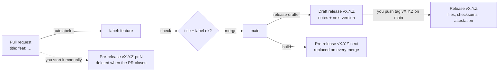

# spali/.github

Shared release configuration and reusable GitHub Actions workflows for my
repositories, independent of the programming language. A repository only
describes how to **build** its release files; everything else (release notes,
version, checks, publishing, attestation) comes from here.

- [How it works](#how-it-works)
- [Features](#features)
- [How to](#how-to): [release](#make-a-release) ·
  [exception version](#release-a-different-version) ·
  [dev build for a pull request](#give-someone-a-dev-build-of-a-pull-request) ·
  [fix the release notes](#fix-where-a-pull-request-appears-in-the-release-notes) ·
  [tag check failed](#the-tag-check-failed) · [verify a release](#verify-a-release) ·
  [emergency](#emergency-change-main-without-a-pull-request)
- [Set up a new repository](#set-up-a-new-repository)
- [Interface](#interface)
- [Maintenance](#maintenance)
- [Troubleshooting](#troubleshooting)

## How it works



1. Every pull request title follows [Conventional Commits](https://www.conventionalcommits.org).
   A label is derived from the title; the title and the label are checked.
2. On every merge to `main`, [release-drafter](https://github.com/release-drafter/release-drafter)
   updates a **draft release** with the notes and the next version, and a
   pre-release `vX.Y.Z-next` is built from that commit.
3. To release, push the tag of the draft on the head of `main`. The release is
   built, attested and the draft is published with its notes.

### Files in this repository

| File | Purpose |
|---|---|
| [`.github/release-drafter.yml`](.github/release-drafter.yml) | Labels, release note categories, version rule, notes template |
| [`.github/workflows/pr.yml`](.github/workflows/pr.yml) | Reusable: label and check pull requests, delete dev builds of closed ones |
| [`.github/workflows/release-prepare.yml`](.github/workflows/release-prepare.yml) | Reusable: update the draft, check a pushed tag, decide kind and version |
| [`.github/workflows/release-publish.yml`](.github/workflows/release-publish.yml) | Reusable: checksums, attestation, publish |
| [`scripts/`](scripts) | The logic of the reusable workflows (Bash), tested in [`tests/`](tests) |
| [`examples/caller/`](examples/caller) | Workflows to copy into a repository |

The reusable workflows load their scripts and `release-drafter.yml` from the
same commit of this repository that the caller pinned (`job.workflow_sha`), so
a repository always runs one consistent version of everything here.

## Features

### Pull request titles and labels

The title becomes the entry in the release notes:
`<type>[(<scope>)][!]: <description>`, with the type one of `build`, `chore`,
`ci`, `docs`, `feat`, `fix`, `perf`, `refactor`, `revert`, `style`, `test`.

When a pull request is opened, reopened or its title is edited, exactly one
label is added (first match wins):

| Title | Label | Release notes section | Version |
|---|---|---|---|
| any type with `!`, e.g. `feat!:`, `fix(api)!:` | `breaking-change` | Breaking Changes | major |
| `<type>(deps):`, e.g. Renovate's `fix(deps):` | `dependencies` | Dependencies | patch |
| `feat:` / `feat(<scope>):` | `feature` | Features | minor |
| `fix:` / `fix(<scope>):` | `fix` | Fixes | patch |
| everything else | `other` | Others | patch |

**Override:** change the label by hand. Labels you set are kept (the
autolabeler only adds). If a pull request has several of these labels, the
first section in the table wins, and the version takes the highest increment.

**Check** (`pr / check`, required for merging): the title must follow the
format and the pull request must have one of the five labels. It runs on every
change of the pull request, also when you change a label.

### Version rule

The next version is the last published release plus the highest increment of
all merged pull requests since: breaking → major, feature → minor, everything
else → patch. There is no special rule for 0.x: a breaking change in 0.4.2
gives 1.0.0. Pre-releases (`-rc.1`, `-next`, `-pr.N`) are never the base.

### Draft release

release-drafter keeps one draft release per repository, named and tagged
`vX.Y.Z`, updated on every merge to `main`. Read it on the releases page to see
what the next release will contain. Edits by hand are overwritten by the next
merge, so add text (e.g. before/after tables of a breaking change) right
before you tag.

### Releases and the tag check

A pushed tag `vX.Y.Z` (or `vX.Y.Z-<suffix>`) starts the release. It only
continues if

1. a **draft** with exactly this tag exists, and
2. the tag points to the **head of `main`** (the commit the draft was computed from).

Otherwise nothing is built and the run fails with the reason. A version with a
suffix (`2.0.0-rc.1`) is published as a pre-release, otherwise as Latest.

### `-next` pre-release

After every merge to `main` a pre-release `vX.Y.Z-next` (the draft's version)
is built from that commit with the draft's notes. All older `-next`
pre-releases and their tags are deleted first, so there is always at most one.

### Dev builds of pull requests

Started by hand on a pull request branch of this repository (not on forks):
a pre-release `vX.Y.Z-pr.N` with the files, and a comment on the pull request
with the link (updated on the next build). A new build for the same pull
request replaces the old one; closing or merging the pull request deletes it.

### Attestation

Every published file set gets `checksums.txt` and a build provenance
attestation over it, signed by the `release-publish.yml` workflow of this
repository. GitHub does not store attestations for private user-owned
repositories; there the step is skipped with a notice.

### Branch and tag protection

Each repository has two rulesets, without any bypass (also not for the owner):

- `main`: changes only through pull requests (no review required), required
  checks must pass, no force push, no deletion.
- release tags `v*` (except `v*-next`, `v*-pr.*`): cannot be moved. Deleting
  is allowed, so a tag that failed the tag check can be removed. **Never delete
  the tag of a published release.**

## How to

All commands run in the repository you release, with the [GitHub CLI](https://cli.github.com).

### Make a release

1. Open the releases page (`gh release list`) and read the draft `vX.Y.Z`.
   Wrong section or version? See [fix the release notes](#fix-where-a-pull-request-appears-in-the-release-notes).
2. Optionally add text to the draft (e.g. migration notes for breaking changes).
3. Tag the head of `main` with exactly the draft's tag and push it:
   ```sh
   git switch main && git pull --ff-only
   git tag vX.Y.Z
   git push origin vX.Y.Z
   ```
4. Watch the run: `gh run watch`. The draft becomes the release with the files.

### Release a different version

For a version the labels would not give (a release candidate, a planned 1.0.0, …):

1. Start the release workflow on `main` with the version:
   ```sh
   gh workflow run Release --ref main -f version=2.0.0-rc.1
   ```
   The draft is now `v2.0.0-rc.1` (and the `-next` pre-release follows it).
2. Push exactly that tag on the head of `main` as in [make a release](#make-a-release).
   If something was merged in between, the draft is back at the computed
   version and the tag check fails: start again from step 1.

### Give someone a dev build of a pull request

1. The pull request branch must be in this repository. For a pull request from
   a fork, push its commits to a branch here and open a pull request from it.
2. Start the build on the branch:
   ```sh
   gh workflow run Release --ref <branch>
   ```
3. The pull request gets a comment with the link to `vX.Y.Z-pr.N`; pass it on.
   Run step 2 again after new commits.

### Fix where a pull request appears in the release notes

- Before merging: fix the title, or change the label on the pull request.
- After merging: change the label on the merged pull request, then update the
  draft by starting the release workflow on `main`:
  `gh workflow run Release --ref main`.

### The tag check failed

The run log names the reason:

| Message | What to do |
|---|---|
| `no draft release for vA (current draft: vB)` | Wrong tag. Delete it, push `vB`. |
| `no draft release for vA (no draft exists, …)` | Nothing merged since the last release. Delete the tag. |
| `tag vA points to X but main is at Y` | Something was merged after you tagged, or you tagged an old commit. Check the draft again, delete the tag, tag the head of `main`. |

Delete a tag: `git push --delete origin vA && git tag -d vA`.

### Verify a release

```sh
gh release download vX.Y.Z --repo spali/<repo> --pattern '<file>'
gh attestation verify <file> --repo spali/<repo>
# stricter: the file was attested by the shared publish workflow
gh attestation verify <file> --repo spali/<repo> \
  --signer-workflow spali/.github/.github/workflows/release-publish.yml
sha256sum --check --ignore-missing checksums.txt
```

### Emergency: change `main` without a pull request

There is no bypass. Settings → Rules → Rulesets → `main` → Enforcement status
**Disabled**, make the change, then set it back to **Active**.

## Set up a new repository

Works for any language. Steps 1–4 are files, 5–8 are settings.

1. **Workflows:** copy [`examples/caller/pr.yml`](examples/caller/pr.yml) to
   `.github/workflows/pr.yml` and one of the release examples to
   `.github/workflows/release.yml`:
   - [`release-generic.yml`](examples/caller/release-generic.yml): any build,
     replace the `Build` step.
   - [`release-go.yml`](examples/caller/release-go.yml): Go with goreleaser.

   Replace every `SHA # vX.Y.Z` with the commit and tag of the latest release
   of this repository: `gh release view --repo spali/.github --json tagName`
   and `git ls-remote https://github.com/spali/.github refs/tags/<tag>`.
2. **Build job:** see [interface](#interface). It builds from
   `needs.prepare.outputs.sha` with `needs.prepare.outputs.version` and
   uploads the files as the artifact `release-assets`. No `checksums.txt`.
   For goreleaser, in `.github/goreleaser.yml`:
   ```yaml
   snapshot:
     version_template: "{{ .Env.VERSION }}"
   checksum:
     disable: true
   ```
3. **Renovate:** `.github/renovate.json` with
   `helpers:pinGitHubActionDigests` (see [this repository's](.github/renovate.json)),
   so the pinned `spali/.github` commits are updated.
4. **First release:** without any published release, release-drafter has no
   baseline and the first draft lists no pull requests. Merge the setup, then
   release that first draft (or an [exception version](#release-a-different-version)).
5. **Labels:**
   ```sh
   for l in breaking-change:b60205 dependencies:0366d6 feature:a2eeef fix:d73a4a other:cfd3d7; do
     gh label create "${l%%:*}" --color "${l##*:}" --force
   done
   ```
6. **Actions settings:** Settings → Actions → General: workflow permissions
   *Read repository contents*, do not allow GitHub Actions to create or approve
   pull requests.
   ```sh
   gh api -X PUT repos/spali/<repo>/actions/permissions/workflow \
     -f default_workflow_permissions=read -F can_approve_pull_request_reviews=false
   ```
7. **Rulesets** (after the workflows ran once, so the check names exist).
   Put the repository's own required checks next to `pr / check`:
   ```sh
   gh api -X POST repos/spali/<repo>/rulesets --input - <<'EOF'
   {"name": "main", "target": "branch", "enforcement": "active", "bypass_actors": [],
    "conditions": {"ref_name": {"include": ["~DEFAULT_BRANCH"], "exclude": []}},
    "rules": [{"type": "deletion"}, {"type": "non_fast_forward"},
      {"type": "pull_request", "parameters": {"required_approving_review_count": 0,
        "dismiss_stale_reviews_on_push": false, "require_code_owner_review": false,
        "require_last_push_approval": false, "required_review_thread_resolution": false,
        "allowed_merge_methods": ["rebase"]}},
      {"type": "required_status_checks", "parameters": {"strict_required_status_checks_policy": false,
        "required_status_checks": [{"context": "pr / check"}]}}]}
   EOF
   gh api -X POST repos/spali/<repo>/rulesets --input - <<'EOF'
   {"name": "release tags", "target": "tag", "enforcement": "active", "bypass_actors": [],
    "conditions": {"ref_name": {"include": ["refs/tags/v*"],
      "exclude": ["refs/tags/v*-next", "refs/tags/v*-pr.*"]}},
    "rules": [{"type": "update"}]}
   EOF
   ```
8. **Renovate app:** make sure the Renovate GitHub app has access to the
   repository (GitHub → Settings → Applications → Renovate → Configure).

## Interface

`release.yml` in a repository has three jobs: `prepare` and `publish` call this
repository, `build` is the repository's own.

**`release-prepare.yml`** (needs `contents: write`, `pull-requests: read`)

| Input | |
|---|---|
| `version` | optional exception version, only on `main` |

| Output | Example | |
|---|---|---|
| `kind` | `release`, `next`, `pr` | what is published |
| `version` | `1.2.0`, `1.2.0-next`, `1.2.0-pr.7` | without `v`, pass to the build |
| `tag` | `v1.2.0` | |
| `sha` | commit | check out and build this commit |
| `pr` | `7` | only for `pr` |
| `draft-id` | `445321074` | only for `release` and `next` |

**`build`** (repository): `needs: prepare`, builds `sha` with `version`,
uploads all files to publish as the artifact **`release-assets`**
(`actions/upload-artifact`). It must not write `checksums.txt` or publish.

**`release-publish.yml`** (needs `contents: write`, `pull-requests: write`,
`id-token: write`, `attestations: write`, `artifact-metadata: write`): takes
all outputs of `prepare` as inputs of the same name.

**`pr.yml`** (needs `contents: write`, `pull-requests: write`): called from
`pull_request_target` with the types `opened, reopened, edited, synchronize,
labeled, unlabeled, closed`. It never checks out code of the pull request, so
`pull_request_target` is safe and labels pull requests from forks too.

The release workflow must keep the tag filters of the examples: `-next` and
`-pr.*` tags must not start a release.

## Maintenance

- **Change something here:** pull request with tests (`bats tests/`,
  `shellcheck -x scripts/*.sh tests/helpers/*.bash`, `actionlint`), merge, then
  tag a new version and create a release:
  ```sh
  git tag vX.Y.Z && git push origin vX.Y.Z
  gh release create vX.Y.Z --generate-notes
  ```
  Renovate then opens pull requests in the repositories to move their pins.
  Breaking changes of the interface: new major version and update the callers.
- **release-drafter and other actions** are pinned by commit and updated by
  Renovate here. actionlint in CI is pinned in `ci.yml` (`go run …@vX`) and
  updated by hand.
- **A tag push runs the workflow files of the tagged commit**, so a fix here
  only applies to releases of commits that pin it.

## Troubleshooting

| Symptom | Cause |
|---|---|
| `pr / check`: `PR title must follow Conventional Commits` | Fix the title. |
| `pr / check`: `PR has none of the labels …` | Add one of the five labels; the check reruns. |
| Draft lists no pull requests (`could not find a previous published release`) | New repository without a release, see [first release](#set-up-a-new-repository). |
| Tag pushed, release failed in `prepare` | [The tag check failed](#the-tag-check-failed). |
| `error: job.workflow_sha unavailable` | GitHub did not provide the called workflow's commit; the workflows cannot load their scripts. |
| `error: the version input only applies on main` | Start the workflow with `version` only on `main`. |
| `error: branch X has no open pull request to main` | Dev builds need an open pull request from a branch of this repository. |
| `error: no release assets found in dist` | The build job uploaded nothing as `release-assets`. |
| Attestation skipped with a notice | Private repository, see [attestation](#attestation). |
